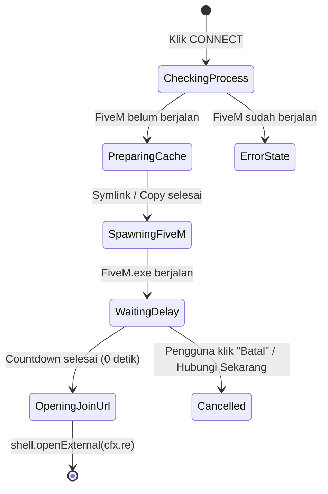

# Blueprint Perombakan UI/UX & Modernisasi Arsitektur FiveM-Hub (`PLAN.md`)

Dokumen ini berisi rencana teknis menyeluruh untuk merombak **FiveM-Hub** dari aplikasi prototipe sederhana menjadi desktop gaming launcher modern, responsif, dan modular dengan standar kualitas produksi.

---

## 1. Audit UI/UX Saat Ini & Visi Desain Baru

### 1.1 Audit Kekurangan UI/UX Saat Ini (`ui/index.html` & `ui/style.css`)
Berdasarkan analisis terhadap implementasi antarmuka saat ini, terdapat beberapa kelemahan mendasar yang menurunkan kenyamanan pengguna (*User Experience*):

1. **Tata Letak (Layout) Satu Kolom yang Kaku & Tidak Proporsional**:
   - Seluruh elemen di `ui/index.html` menempel langsung ke tepi `<body>` tanpa pembungkus (*wrapper* / *grid system*), sehingga pada jendela berukuran `1000×700px`, kartu server merentang terlalu lebar dengan banyak ruang kosong (*dead space*) yang tidak termanfaatkan.
   - Modal pengaturan (`#settingsModal` dengan lebar statis `500px`) menumpuk seluruh kontrol (FiveM Path, Process Priority, CPU Affinity, Launch Delay, dan Cache Profiles) secara vertikal tanpa pengelompokan kartu atau navigasi tab, sehingga konten mudah meluap (*overflow*) di layar resolusi kecil.
2. **Tipografi & Hierarki Visual Lemah**:
   - Menggunakan font sistem `Arial` tanpa skala tipografi (*type scale*), ketebalan (*font-weight*), maupun *letter-spacing* yang jelas.
   - Semua tombol (`<button>`) menggunakan satu gaya warna solid mencolok (`#ff0066`) tanpa pembedaan antara **Primary Action** (seperti *Connect*), **Secondary Action** (seperti *Browse* / *Export*), **Toggle State** (seperti *Priority* / *Affinity* yang sedang aktif), dan **Destructive Action** (seperti *Delete Profile*).
3. **Kurangnya Visual Feedback & State Indikator**:
   - Pengguna tidak dapat melihat tombol **CPU Affinity** atau **Priority** mana yang sedang aktif secara visual (hanya teks biasa `"Current Priority: ..."`).
   - Penggunaan dialog bawaan browser (`alert()` dan `confirm()`) menghentikan eksekusi thread UI, terasa usang untuk aplikasi desktop modern, dan memecah fokus pengguna.
   - Saat menekan tombol **CONNECT**, pengguna hanya melihat teks `"Launching..."` tanpa mengetahui tahapan proses di belakang layar (apakah sedang menyalin cache ratusan MB, membuka `FiveM.exe`, atau sedang menghitung mundur *launch delay* 30 detik).
4. **Window Frame Bawaan OS yang Kaku**:
   - Masih menggunakan *titlebar* standar Windows yang tidak menyatu dengan tema gelap aplikasi.

---

### 1.2 Visi Desain Baru (Modern Desktop Gaming Launcher)
Desain baru mengusung konsep **Frameless Sidebar + Bento Grid Layout** yang terinspirasi dari launcher modern (seperti *Riot Client*, *Linear*, dan *Discord*):

* **Custom Frameless Titlebar**: Jendela Electron menggunakan `titleBarStyle: "hidden"` (atau `frame: false`) dengan area drag (`-webkit-app-region: drag`), logo aplikasi di kiri, indikator status proses `FiveM.exe` (*Running* / *Idle*) di tengah/kanan, serta tombol kontrol jendela (*Minimize*, *Maximize*, *Close*) kustom.
* **Sidebar Navigation Layout**: Navigasi kiri yang ringkas untuk berpindah antar tampilan utama tanpa *modal* yang menumpuk:
  1. **Servers (Dashboard Utama)**: Pencarian instan, filter kategori, dan grid kartu server.
  2. **Cache Profiles**: Manajer profil cache visual lengkap dengan informasi ukuran disk dan status tautan (*Symlink/Copy*).
  3. **Performance & Tuning**: Pengaturan *Process Priority*, *CPU Core Affinity Picker* interaktif, dan *Launch Delay*.
  4. **Settings & Backup**: Lokasi instalasi `FiveM.exe`, *Theme Switcher* (4 pilihan tema), serta *Export/Import Config*.
* **Subtle Glassmorphism & Surface Elevation**: Menggunakan lapisan latar bertingkat (`--bg-primary`, `--bg-surface`, `--bg-elevated`) yang dipadukan dengan `backdrop-filter: blur(12px)` dan garis tepi tipis (`1px solid var(--border-subtle)`) untuk menciptakan kedalaman visual tanpa mengorbankan performa GPU.
* **Micro-Interactions & Skeleton Loading**:
  - Efek *hover lift* halus (`transform: translateY(-2px)`), *active press scale* (`scale(0.98)`), dan transisi `150ms cubic-bezier(0.22, 1, 0.36, 1)`.
  - Efek *shimmer skeleton* saat aplikasi sedang mengambil status pemain dari API, serta animasi *pulsing dot* pada indikator server yang sedang *Online*.

#### Wireframe Struktur Layout Baru (ASCII)
```text
+-----------------------------------------------------------------------------------+
| [Logo] FiveM Hub          [ ● FiveM: Idle ]                  [ Theme ] [ _ ][ □ ][ X ] | <- Custom Titlebar (Draggable)
+------------------+----------------------------------------------------------------+
| NAVIGASI         |  [ 🔍 Cari server...               ] [Semua] [★ Favorit] [🟢 Online] | <- Action & Filter Bar
|                  |                                        [ ↻ Refresh ] [ + Server ] |
| [🏠] Servers     +----------------------------------------------------------------+
| [⚡] Performance |  +----------------------------------+  +----------------------------------+
| [💾] Cache Hub   |  | [Logo] INDOPRIDE RP          [★] |  | [Logo] JING ARENA            [☆] |
| [⚙️] Settings    |  | 🟢 Online        Build 3258      |  | 🟢 Online        Build 3788      |
|                  |  | 👥 184 / 200 Players             |  | 👥 42 / 64 Players               |
|                  |  | [██████████████████░░] 92%       |  | [█████████████░░░░░░░] 65%       |
|                  |  | 📦 Cache: indopride  [✎] [🗑]   |  | 📦 Cache: jing       [✎] [🗑]   |
|                  |  | [         ▶ CONNECT          ]   |  | [         ▶ CONNECT          ]   |
|                  |  +----------------------------------+  +----------------------------------+
|                  |                                                                |
|------------------+----------------------------------------------------------------+
| 🚀 Status Peluncuran: Menunggu FiveM siap... (Countdown: 18d) [██████░░░░] [Batal] | <- Persistent Launch Status Bar
+-----------------------------------------------------------------------------------+
```

---

## 2. Rekomendasi Template & Palet Warna (Color Palettes)

Seluruh warna didefinisikan menggunakan **CSS Custom Properties (Variables)** pada `:root` dan atribut `[data-theme="<nama-tema>"]` di `ui/style.css`, sehingga pengguna dapat mengganti tema secara *real-time* tanpa memuat ulang aplikasi.

### 2.1 Tema A: **Obsidian Cyber (Ultra Dark — Default Recommended)**
Dominasi hitam pekat (*OLED-friendly*) dengan aksen **Neon Emerald/Cyan** yang tajam dan kontras tinggi.

| CSS Variable | Kode HEX | Nilai HSL | Kegunaan |
| :--- | :--- | :--- | :--- |
| `--bg-primary` | `#050507` | `hsl(240, 14%, 3%)` | Latar belakang utama aplikasi (Body / Canvas) |
| `--bg-surface` | `#0D0E12` | `hsl(228, 16%, 6%)` | Latar belakang Sidebar, Kartu Server, dan Panel |
| `--bg-elevated` | `#161821` | `hsl(231, 20%, 11%)` | Elemen melayang (Modal, Dropdown, Hover Kartu, Input) |
| `--text-primary` | `#F3F4F6` | `hsl(220, 14%, 96%)` | Teks judul, nama server, dan label utama |
| `--text-muted` | `#8E95A5` | `hsl(222, 11%, 60%)` | Teks sekunder, metadata build, dan placeholder |
| `--accent-primary` | `#00E599` | `hsl(160, 100%, 45%)` | Tombol utama (*Connect*), tab aktif, & highlight |
| `--accent-hover` | `#00FFAA` | `hsl(160, 100%, 50%)` | State hover pada tombol/elemen aksen utama |
| `--border-subtle` | `#1F222E` | `hsl(228, 19%, 15%)` | Garis pemisah kartu, input, dan struktur layout |
| `--status-online` | `#10B981` | `hsl(160, 84%, 39%)` | Indikator server Online & aksi berhasil |
| `--status-offline` | `#EF4444` | `hsl(0, 84%, 60%)` | Indikator server Offline & tombol hapus (*Danger*) |
| `--status-warning` | `#F59E0B` | `hsl(38, 92%, 50%)` | Peringatan (Realtime Priority, Cache belum ada, Favorit) |

---

### 2.2 Tema B: **Midnight Slate (Modern Glass)**
Nuansa abu-abu kebiruan gelap (*deep slate*) ala **Discord / Linear** dengan aksen **Indigo-Violet** yang elegan dan nyaman untuk penggunaan jangka panjang.

| CSS Variable | Kode HEX | Nilai HSL | Kegunaan |
| :--- | :--- | :--- | :--- |
| `--bg-primary` | `#0B0F19` | `hsl(223, 39%, 7%)` | Latar belakang utama aplikasi |
| `--bg-surface` | `#131B2E` | `hsl(222, 41%, 13%)` | Latar belakang Sidebar, Kartu Server, dan Panel |
| `--bg-elevated` | `#1E2942` | `hsl(222, 37%, 19%)` | Elemen melayang (Modal, Dropdown, Hover Kartu) |
| `--text-primary` | `#F8FAFC` | `hsl(210, 40%, 98%)` | Teks judul, nama server, dan label utama |
| `--text-muted` | `#94A3B8` | `hsl(215, 20%, 65%)` | Teks sekunder, metadata build, dan placeholder |
| `--accent-primary` | `#6366F1` | `hsl(239, 84%, 67%)` | Tombol utama (*Connect*), tab aktif, & highlight |
| `--accent-hover` | `#818CF8` | `hsl(234, 89%, 74%)` | State hover pada tombol/elemen aksen utama |
| `--border-subtle` | `#26334D` | `hsl(220, 34%, 23%)` | Garis pemisah kartu, input, dan struktur layout |
| `--status-online` | `#22C55E` | `hsl(142, 71%, 45%)` | Indikator server Online & aksi berhasil |
| `--status-offline` | `#F43F5E` | `hsl(350, 89%, 60%)` | Indikator server Offline & tombol hapus (*Danger*) |
| `--status-warning` | `#EAB308` | `hsl(48, 96%, 47%)` | Peringatan & ikon bintang Favorit |

---

### 2.3 Tema C: **Crimson Amber RP (Warm Gaming)**
Nuansa gelap hangat (*charcoal obsidian*) dengan aksen **Crimson Red / Sunset Amber** khas atmosfer *Grand Theft Auto / FiveM Roleplay*.

| CSS Variable | Kode HEX | Nilai HSL | Kegunaan |
| :--- | :--- | :--- | :--- |
| `--bg-primary` | `#0C090A` | `hsl(340, 14%, 4%)` | Latar belakang utama aplikasi |
| `--bg-surface` | `#161113` | `hsl(336, 13%, 8%)` | Latar belakang Sidebar, Kartu Server, dan Panel |
| `--bg-elevated` | `#241B1E` | `hsl(340, 14%, 12%)` | Elemen melayang (Modal, Dropdown, Hover Kartu) |
| `--text-primary` | `#FAF5F6` | `hsl(348, 33%, 97%)` | Teks judul, nama server, dan label utama |
| `--text-muted` | `#A39398` | `hsl(341, 8%, 61%)` | Teks sekunder, metadata build, dan placeholder |
| `--accent-primary` | `#F43F5E` | `hsl(350, 89%, 60%)` | Tombol utama (*Connect*), tab aktif, & highlight |
| `--accent-hover` | `#FB7185` | `hsl(351, 95%, 71%)` | State hover pada tombol/elemen aksen utama |
| `--border-subtle` | `#2E2226` | `hsl(340, 15%, 16%)` | Garis pemisah kartu, input, dan struktur layout |
| `--status-online` | `#10B981` | `hsl(160, 84%, 39%)` | Indikator server Online & aksi berhasil |
| `--status-offline` | `#EF4444` | `hsl(0, 84%, 60%)` | Indikator server Offline & tombol hapus (*Danger*) |
| `--status-warning` | `#F97316` | `hsl(25, 95%, 53%)` | Peringatan & aksen sekunder Amber |

---

### 2.4 Tema D: **Clean Monochrome (Minimalist Pro)**
Desain monokromatik berfokus pada tipografi tajam dan kontras tinggi hitam-putih-abu ala **Vercel / Next.js**, bebas distraksi warna mencolok.

| CSS Variable | Kode HEX | Nilai HSL | Kegunaan |
| :--- | :--- | :--- | :--- |
| `--bg-primary` | `#09090B` | `hsl(240, 10%, 4%)` | Latar belakang utama aplikasi |
| `--bg-surface` | `#121215` | `hsl(240, 8%, 8%)` | Latar belakang Sidebar, Kartu Server, dan Panel |
| `--bg-elevated` | `#1C1C21` | `hsl(240, 8%, 12%)` | Elemen melayang (Modal, Dropdown, Hover Kartu) |
| `--text-primary` | `#FAFAFA` | `hsl(0, 0%, 98%)` | Teks judul, nama server, dan label utama |
| `--text-muted` | `#A1A1AA` | `hsl(240, 5%, 65%)` | Teks sekunder, metadata build, dan placeholder |
| `--accent-primary` | `#FFFFFF` | `hsl(0, 0%, 100%)` | Tombol utama (*Connect* dengan teks `#09090B`) |
| `--accent-hover` | `#E4E4E7` | `hsl(240, 6%, 90%)` | State hover pada tombol/elemen aksen utama |
| `--border-subtle` | `#27272A` | `hsl(240, 4%, 16%)` | Garis pemisah kartu, input, dan struktur layout |
| `--status-online` | `#22C55E` | `hsl(142, 71%, 45%)` | Indikator server Online & aksi berhasil |
| `--status-offline` | `#EF4444` | `hsl(0, 84%, 60%)` | Indikator server Offline & tombol hapus (*Danger*) |
| `--status-warning` | `#F59E0B` | `hsl(38, 92%, 50%)` | Peringatan & ikon bintang Favorit |

---

## 3. Perombakan Komponen UI & Pengalaman Pengguna (UX Flow)

### 3.1 Sistem Notifikasi Modern (Pengganti `alert()` & `confirm()`)
Seluruh pemanggilan `alert()` dan `confirm()` akan dihapus dan digantikan oleh dua komponen non-blocking:
1. **Toast Notification Stack (`#toastContainer`)**:
   - Muncul di sudut kanan bawah layar dengan animasi *slide-in* dan otomatis hilang setelah `3.5 detik` (dilengkapi progress bar waktu di bagian bawah toast).
   - Mendukung 4 varian: `success` (hijau), `error` (merah), `warning` (kuning/oranye), dan `info` (aksen).
2. **Custom Confirmation Modal (`showConfirmModal(options)`)**:
   - Mengembalikan `Promise<boolean>` sehingga dapat langsung digunakan dengan `const ok = await showConfirmModal({ title, message, danger: true })`.
   - Digunakan saat konfirmasi penghapusan profil cache, penghapusan server, atau peringatan pemilihan *Realtime Priority*.

### 3.2 Redesain Kartu Server (*Server Card Component*)
Setiap kartu server dirancang dalam format **Bento Card** dengan hierarki visual yang jelas:
* **Header Kartu**:
  - **Logo Server** (`56×56px`, sudut membulat `12px`, dengan *fallback avatar* inisial server bila gambar tidak ditemukan).
  - **Judul & Badge Status**: Nama server (`font-weight: 700`), tombol bintang Favorit di sudut kanan atas (dengan animasi *pop* saat diklik), dan *Status Pill* (`🟢 Online` dengan titik berdenyut / `🔴 Offline`).
* **Body Kartu (Metrik & Tag)**:
  - **Player Capacity Bar**: Menampilkan jumlah pemain (`👥 184 / 200`) beserta *visual progress bar* horizontal yang berubah warna secara dinamis (Hijau `< 75%`, Kuning `75%–90%`, Merah `> 90%` penuh).
  - **Metadata Pills**: Menampilkan pill `Build 3258`, `📦 Cache: indopride` (beserta indikator apakah cache profil sudah tersimpan atau masih kosong), dan kode endpoint `cfx.re`.
* **Footer Kartu**:
  - Tombol utama **CONNECT** selebar kartu dengan ikon *Play*, serta tombol aksi cepat (*Quick Actions*: Edit Server & Simpan Cache Saat Ini).

### 3.3 Navigasi Ber-Tab / Panel Pengaturan & Manajemen Cache
Alih-alih menumpuk semuanya dalam satu modal sempit, antarmuka dibagi menjadi **4 View Terstruktur**:
1. **View 1 — Server Hub (Beranda)**:
   - Dilengkapi **Search Bar** (*real-time filtering* berdasarkan nama server, build, atau kode endpoint), **Filter Tabs** (*Semua*, *★ Favorit*, *🟢 Online Saja*), tombol **Refresh Status**, dan tombol **+ Tambah Server**.
2. **View 2 — Performance & Tuning**:
   - **Process Priority Selector**: 4 kartu radio interaktif (*Normal*, *Above Normal*, *High*, *Realtime*) yang menampilkan *active ring* pada opsi yang sedang terpilih beserta deskripsi dampaknya secara langsung tanpa perlu dialog `confirm()` berulang.
   - **Interactive CPU Core Affinity Picker**: Menyediakan preset cepat (*All Cores*, *4 Cores*, *6 Cores*, *8 Cores*) sekaligus **Grid Checkbox per Thread/Core CPU** (mendeteksi jumlah core logis PC pengguna via `os.cpus().length`), lalu otomatis menghitung nilai bitmask heksadesimalnya.
   - **Launch Delay Slider / Selector**: Pengaturan jeda waktu sebelum membuka link `cfx.re/join/...` (`5d` hingga `90d`).
3. **View 3 — Cache Profile Manager**:
   - Menampilkan daftar seluruh profil cache dalam bentuk **Tabel/Grid Kartu Profil** (bukan sekadar dropdown `<select>`), lengkap dengan:
     - Nama profil & server yang terhubung.
     - Status ketersediaan (`Tersimpan` vs `Kosong`) dan **ukuran folder di disk** (mis. `1.42 GB`).
     - Tombol aksi langsung pada tiap kartu profil: **Load Cache**, **Update dari Cache Aktif**, dan **Hapus Profil**.
4. **View 4 — General Settings**:
   - Pemilih lokasi `FiveM.exe` beserta tampilan otomatis lokasi `cachePath` (`FiveM.app\data`) dan indikator validitas file.
   - **Pilihan Mode Cache**: Toggle antara *Standard Copy Mode* vs *Fast Symlink/Junction Mode (Instan)*.
   - **Theme Switcher**: Pemilih visual ke-4 palet warna.
   - **Backup & Restore**: Tombol *Export Config* dan *Import Config*.

---

## 4. Modernisasi Fungsi & Arsitektur Sistem (Backend & IPC)

### 4.1 Modularisasi Kode (Memecah Monolitik `main.js` & `ui/app.js`)
Untuk menjaga keterbacaan, kemudahan pengujian, dan *separation of concerns*, struktur kode akan dipecah menjadi modul-modul terfokus:

```mermaid
flowchart LR
    subgraph Renderer ["Renderer Process (ui/)"]
        AppJS["ui/app.js (Entry & Router)"]
        Store["ui/state.js (Reactive UI State)"]
        Toast["ui/components/toast.js"]
        Modal["ui/components/modal.js"]
        ServerGrid["ui/components/serverGrid.js"]
        SettingsView["ui/components/settingsView.js"]
        AppJS --> Store
        AppJS --> Toast
        AppJS --> Modal
        AppJS --> ServerGrid
        AppJS --> SettingsView
    end

    subgraph Preload ["Preload Bridge"]
        PreloadJS["preload.js (contextBridge fivemAPI)"]
    end

    subgraph Main ["Main Process (src/main/)"]
        MainEntry["main.js (Window & App Lifecycle)"]
        IPC["src/main/ipcHandlers.js"]
        ConfigMgr["src/main/configManager.js"]
        ServerMgr["src/main/serverManager.js"]
        CacheMgr["src/main/cacheManager.js"]
        Launcher["src/main/processLauncher.js"]
        StatusSvc["src/main/serverStatusService.js"]

        MainEntry --> IPC
        IPC --> ConfigMgr
        IPC --> ServerMgr
        IPC --> CacheMgr
        IPC --> Launcher
        IPC --> StatusSvc
    end

    Renderer <-->|"IPC Invoke & Event Stream"| Preload
    Preload <--> Main
```



* **`src/main/configManager.js`**: Mengelola pembacaan, validasi skema, migrasi, serta penyimpanan `config.json` di `app.getPath("userData")` (termasuk penyimpanan preferensi tema `theme` dan mode cache `cacheMode`).
* **`src/main/serverManager.js`**: Mengelola daftar server di `userData/servers.json` (menyalin data awal dari `data/servers.json` bawaan saat pertama kali dijalankan), serta menyediakan operasi CRUD (*Tambah*, *Edit*, *Hapus* server).
* **`src/main/cacheManager.js`**: Mengelola profil cache, validasi path, perhitungan ukuran direktori (`getProfileStats`), dan pergantian cache menggunakan **Directory Junction (`fs.symlink` tipe `'junction'`)** dengan *fallback* otomatis ke `fsExtra.copy`.
* **`src/main/processLauncher.js`**: Menangani pengecekan proses `FiveM.exe`, peluncuran dengan flag *priority/affinity*, pengiriman *real-time progress event* ke UI, serta kemampuan membatalkan (*cancel*) *countdown launch delay*.
* **`src/main/serverStatusService.js`**: Mengambil status server dengan dukungan **Dual-Source Fallback** (mencoba API `fivestats.io` terlebih dahulu jika `apiKey` tersedia, lalu otomatis *fallback* ke endpoint publik resmi `https://servers-frontend.fivem.net/api/servers/single/${endpoint}` jika `apiKey` kosong atau gagal).

---

### 4.2 Peningkatan Sistem Peluncuran, Cache, & Status Server

#### A. Real-Time Launch Progress & Countdown Stream
Saat pengguna menekan tombol **CONNECT**, Main Process mengirimkan event progres (`webContents.send("launch-progress", payload)`) ke Renderer Process secara bertahap:



1. `step: "checking"` — *"Memeriksa status aplikasi FiveM..."*
2. `step: "cache"` — *"Memuat profil cache `<nama_profil>`..."*
3. `step: "launching"` — *"Meluncurkan FiveM.exe (Priority: High)..."*
4. `step: "countdown"` — Menampilkan *progress bar* di bagian bawah layar: *"Menunggu FiveM siap... Menghubungkan ke server dalam 28 detik"* dilengkapi dua tombol pintas: **[Hubungkan Sekarang]** (langsung membuka link tanpa menunggu sisa detik) dan **[Batalkan]**.
5. `step: "connected"` — *"Membuka koneksi server di FiveM!"*

#### B. Pergantian Cache Instan via Windows Directory Junction
* Di Windows, pembuatan **Directory Junction** (`fs.symlink(sourceDir, targetDir, "junction")`) **tidak membutuhkan hak akses Administrator** (berbeda dengan *file symlink* biasa) dan berlangsung dalam waktu **< 10 milidetik** tanpa menyalin ulang data berukuran ratusan MB/GB.
* **Alur Kerja Mode Junction / Fallback**:
  1. Saat fitur Junction diaktifkan, `cacheManager` menautkan `FiveM.app/data/server-cache` dan `server-cache-priv` langsung ke `userData/Profiles/<profileName>/server-cache` menggunakan tipe `'junction'`.
  2. Setiap file cache baru yang diunduh FiveM saat bermain di server tersebut otomatis tersimpan langsung di dalam folder profil server terkait tanpa perlu menekan tombol *Save Cache* secara manual.
  3. Jika pembuatan junction gagal (misalnya karena batasan sistem file tertentu), sistem secara transparan melakukan *fallback* ke metode `fsExtra.copy` yang sudah diamankan.

#### C. Fallback API Publik Cfx.re (`serverStatusService.js`)
* Saat ini, jika pengguna tidak memiliki `apiKey` untuk `fivestats.io`, status seluruh server selalu tampil `🔴 Offline`.
* Dengan `serverStatusService.js`:
  - Jika `config.apiKey` tersedia, gunakan `https://fivestats.io/api/servers/${endpoint}`.
  - Jika `config.apiKey` kosong atau request gagal (`401`/`403`/`5xx`), otomatis *fallback* ke API publik Cfx.re (`https://servers-frontend.fivem.net/api/servers/single/${endpoint}`) yang mengembalikan `Data.clients` dan `Data.sv_maxclients` tanpa memerlukan API key.

#### D. Manajemen Server Dinamis (CRUD Server di UI)
* Pengguna dapat menekan tombol **+ Tambah Server** atau ikon **Edit (`✎`)** pada kartu server untuk membuka modal form:
  - **Nama Server** (contoh: `INDOPRIDE RP`)
  - **Kode Join / URL Cfx.re** (otomatis mengekstrak kode `endpoint`, contoh: `cfx.re/join/237yxy` $\rightarrow$ `237yxy`)
  - **Nomor Build Game** (contoh: `3258`)
  - **Profil Cache Terkait** (otomatis membuat/menautkan profil cache dengan ID server)
  - **Logo Server** (pilih dari daftar gambar yang ada atau unggah gambar lokal dari PC pengguna ke `userData/assets/`).

---

## 5. Tahapan Eksekusi (Implementation Roadmap)

Agar proses perombakan berjalan terkontrol, aman, dan mudah diuji pada setiap langkahnya, pengerjaan dibagi menjadi **4 Fase Berurutan**:

### Fase 1: Fondasi Desain, Sistem Tema (4 Palet), & Custom Layout Shell
* **Target File**: `ui/style.css`, `ui/index.html`, `main.js` (konfigurasi window), `preload.js`.
* **Ruang Lingkup**:
  1. Implementasi seluruh CSS Variables untuk ke-4 tema (**Obsidian Cyber**, **Midnight Slate**, **Crimson Amber RP**, **Clean Monochrome**) beserta fitur *Theme Switcher* yang tersimpan di `config.json`.
  2. Perombakan struktur HTML menjadi **Frameless Custom Titlebar + Sidebar Navigation + Bento Grid Main Area**.
  3. Pembuatan komponen **Toast Notification** dan **Custom Confirmation Modal** untuk menggantikan seluruh `alert()` dan `confirm()`.

### Fase 2: Redesain Server Hub, Search/Filter Instan, & Peluncuran Real-Time
* **Target File**: `ui/app.js` (beserta modul UI), `main.js`, `preload.js`.
* **Ruang Lingkup**:
  1. Implementasi desain baru **Server Card** (dengan *Player Capacity Progress Bar*, *Pulsing Status Dot*, *Skeleton Loading*, dan *Fallback Avatar*).
  2. Penambahan fitur **Search Bar** instan, **Filter Tab** (*Semua*, *Favorit*, *Online*), dan tombol **Refresh Status**.
  3. Implementasi **Persistent Launch Status Bar** di UI yang terhubung dengan event `launch-progress` dari Main Process (lengkap dengan *countdown timer*, tombol *Hubungkan Sekarang*, dan tombol *Batalkan*).

### Fase 3: Modularisasi Backend, Fallback API Cfx.re, & CRUD Server Dinamis
* **Target File**: `src/main/*`, `main.js`, `preload.js`, `ui/`.
* **Ruang Lingkup**:
  1. Memecah logika `main.js` ke dalam modul terpisah (`configManager.js`, `serverManager.js`, `cacheManager.js`, `processLauncher.js`, `serverStatusService.js`).
  2. Menambahkan *fallback* otomatis ke API publik Cfx.re ketika `apiKey` `fivestats.io` kosong atau mengalami error.
  3. Menambahkan fitur **Tambah, Edit, dan Hapus Server (CRUD)** langsung dari UI yang disimpan ke `userData/servers.json`.

### Fase 4: Modernisasi Panel Performance & Cache Hub (Symlink + Ukuran Disk)
* **Target File**: `src/main/cacheManager.js`, `ui/`.
* **Ruang Lingkup**:
  1. Merombak halaman **Cache Profile Manager** menjadi tampilan kartu/tabel visual yang menampilkan **ukuran disk (MB/GB)** tiap profil dan status cache-nya.
  2. Mengimplementasikan opsi **Fast Symlink/Directory Junction Mode** untuk pergantian cache instan beserta *fallback* ke metode salin.
  3. Merombak halaman **Performance & Tuning** dengan indikator aktif yang jelas serta pemilih **CPU Core Affinity** visual berbasis jumlah core CPU pengguna.
